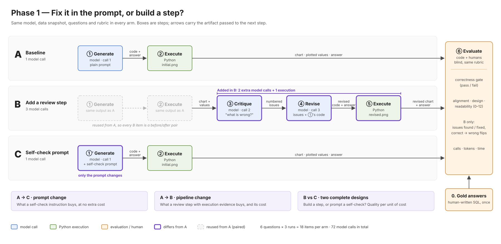

# Phase 1 — Experiments A, B, C: "fix it in the prompt, or build a step?"

- **Status:** agreed scope for phase 1 (v1.3, 2026-10-14). A and B are the team's design; C added by Bo; pilot round and failure handling (sections 8–9) added from teammate suggestions. Phase 1 runs **A, B and C only**.

## 1. The story

Every applied AI team hits the same fork: when a model's output is not good enough, do you **rewrite the prompt** or **add a step to the pipeline**? Phase 1 measures both on the same task.

- **A — Baseline.** One model call writes plotting code and a text answer for a question about NYC crash data; Python runs the code. This is what a single call produces today.
- **B — Add a review step.** Same as A, then the model reviews its own executed result (the chart and the values it actually plotted), lists specific problems, and revises the code. Two extra calls, and the reviewer sees **evidence from execution**.
- **C — Ask for a self-check in the prompt.** Same single call as A, but the prompt also tells the model to check its work for specific problems and fix them before answering. Same architecture and output format as A; only the prompt changes.

The three comparisons:

| Comparison | What changes | What it tells us |
|---|---|---|
| A → C | only the prompt | how much a self-check instruction buys, at no extra cost |
| A → B | two extra calls; review sees execution results | how much a review step with evidence buys, and at what cost |
| **B vs C** | two complete designs | **"build a step with execution feedback" vs "prompt a self-check"**: quality gained per unit of cost |

**Wording rule for results.** B vs C compares two designs, not one factor. B differs from C in three ways at once: its reviewer sees execution results, it uses separate calls, and it costs 3× the calls. Report it as "a pipeline with execution feedback vs a single-call self-check prompt", with cost next to quality. Do not claim "separate calls beat prompting": execution results can only reach the model in a new call after the code runs, and prior work attributes most of such gains to that evidence (CRITIC).

## 2. Workflow

Figure source: `docs/figures/phase1-workflow.svg` (edit this); `phase1-workflow.png` is a 2× export for slides. The table below gives the exact inputs and outputs of each step.

| Step | Who | Input | Output |
|---|---|---|---|
| 0. Reference answers (once) | human, SQL | question + data | gold numbers per question |
| ① Generate | model, call 1 | prompt template + question + data dictionary | plotting code + text answer |
| ①′ Generate with self-check (C only) | model, call 1 | ①'s template + self-check instruction + question + data dictionary | plotting code + text answer (same format as ①) |
| ② Execute | Python | code + data | `initial.png`, plotted values, run log (errors included) |
| ③ Critique (B only) | model, call 2 | `initial.png` + question + plotted values + data dictionary; "看看这张图，有什么问题？指出具体问题" | numbered issue list |
| ④ Revise (B only) | model, call 3 | code from ① + issues from ③ + question; "根据这些建议修改代码" | revised code + revised text answer |
| ⑤ Execute (B only) | Python | revised code + data | `revised.png`, plotted values, run log |
| ⑥ Evaluate | code + humans | final outputs + gold numbers + logs | scores, cost |

| Arm | Path | Model calls |
|---|---|---|
| A | ① → ② → ⑥ | 1 |
| B | ① → ② → ③ → ④ → ⑤ → ⑥ (reuses A's ① and ②) | 3 |
| C | ①′ → ② → ⑥ | 1 |

B is **paired** with A: it revises A's exact output, so each B item has a before/after pair. C is **unpaired**: it generates independently, so A and C are compared as distributions over 3 repeats.

## 3. Controls

- Same model, temperature, data snapshot (2013–2025 window), data dictionary, questions, tools and rubric for all arms.
- C's self-check instruction is **as generic as ③ and ④**, e.g. "Before giving your final answer, check your code and conclusion for specific problems and fix them. Output only the final code and answer." No checklist of specific traps (denominator, partial years, unknown borough): that would add domain knowledge, a different lever, and make B vs C unfair.
- C does not show its self-check, so C has no discovery data. Accepted, to keep A → C a pure prompt change.

## 4. Image input — decide with the model choice

③ sends `initial.png`. E005: big-pickle and nemotron cannot read images; mimo can. The model is chosen by a stability screen (call success, output-format compliance, repeat consistency), not by answer quality.

- **Non-vision model:** the image is ignored; ③ reviews the plotted values, which are still execution evidence. Record this in every run's metadata.
- **Vision model:** ③ also sees the chart. C never sees an image, because none exists before execution.

## 5. Evaluation

Team rubric, unchanged: correctness gate (values, units, aggregation, conclusion; any important misleading claim → fail), then question alignment, chart design, readability (0–4 each, 0–12 total); blind scoring with arm labels hidden and order randomized; time, tokens and calls per arm.

Additions:
1. ③ outputs a **numbered issue list**; each issue is labelled against the question's trap IDs and gold numbers → **discovery** (real problems found) and **false alarms**.
2. For each B pair: **found and fixed / found but not fixed / not found**.
3. **Correct → incorrect flips** in B, reported separately (B reviews every output, including correct ones; Tyen et al. measured up to −11 points from repairing correct outputs).
4. Output-format failures per arm.

Summary table per arm: gate pass rate, mean 0–12, Δ vs A, improved/same/worse (B), flips (B), discovery and false-alarm rates (B), calls, tokens, time.

## 6. Predictions, written before running

| Comparison | Prediction | Basis |
|---|---|---|
| A → C | ≈ 0 on correctness, possibly slightly negative; may improve wording and chart design | Huang et al. ICLR'24; Self-Refine (GSM8K +0); Self-Debug without execution (Codex 61.4 → 57.6). Caveat: Huang et al. also found a better initial prompt can beat multi-call self-refine, so C is not a foregone loss |
| A → B | gains where plotted values reveal the error; some correct → incorrect flips | CRITIC; Text2Vis (execution feedback 26% → 34–42%); Tyen et al. |
| B vs C | B ≥ C on correctness; C far cheaper | follows from the two rows above |

## 7. Size and limits

- 6 clear questions × 3 runs = 18 items per arm. Calls: A 18 + B 36 + C 18 = **72**. $0 with free models.
- 18 items detect only large effects. B vs A: paired tests (McNemar on gate pass, sign test on score change). C vs A: compare pass rates descriptively. Phase 1 is a pilot.
- Clear questions contain few traps, so B's reviewer has little to find and flips are the main risk. Questions 7–10 (ambiguous / insufficient evidence) are where review should matter; include them when possible.
- B spends 3× the calls of A and C; part of any gain may come from extra compute.
- Not in phase 1: a variant that merges ③ and ④ into one call. It would separate "sees execution results" from "separate calls", and can be added later from A's saved outputs without re-running anything.

## 8. Pilot round before the formal runs (teammate suggestion)

Run a few questions first and use the outcomes to write the critique/revise prompt (B) and the self-check prompt (C).

Rules that keep this from contaminating the result:

1. **Disjoint questions.** Pilot questions must not be among the formal questions. Tuning prompts on the questions you then score inflates B and C relative to A. Use a separate pilot set (for example the E002 questions in `experiments/E002-baseline/questions.json`, or 2 held-out questions of the same types).
2. **Equal tuning budget for B and C.** Same number of pilot questions, same number of prompt iterations (suggest at most 3 each). Otherwise B vs C measures tuning effort, not design.
3. **Freeze before the formal run.** Record prompt text and hash in the run metadata; no edits after the first formal call.
4. **Generic wording stays generic.** Outcome-informed edits may fix format, clarity and which artifacts to look at. They must not add trap-specific checklists (denominator, partial years, unknown borough). If domain notes are added, add them to B and C alike and report that run as a different lever.
5. **Log the pilot.** Each prompt version, the failures it fixed, and what it did not fix, in `experiments/LOG.md`.

## 9. Failure handling (teammate question: if A errors, does B continue?)

Classify the failure first; the treatment depends on its kind. Decide the rules now, before seeing data.

| Failure kind | Evidence in the log | Handling | Counts as |
|---|---|---|---|
| **Call failure** (HTTP error, client crash, empty reply, or timeout with **no completed step**) | API error text or crash dump; no model output | Retry the same call up to 2 times | Not a model result. Report retries and unrecoverable failures per arm; exclude symmetrically |
| **Non-completion** (timeout or step cap reached after ≥ 1 completed step, no chart or no answer) | steps and tool calls logged, artifacts missing | No retry | A failed item for that arm (the model was working but did not finish) |
| **Format failure** (reply has no code block or no answer section) | model output exists, parser fails | No retry | Model non-compliance: a failed item for that arm |
| **Execution failure** (code errors, no chart) — *superseded 2026-10-15, see below* | traceback in the run log | ~~B continues~~ | ~~recovery~~ |
| **Wrong but runs** | gate fails on values | B continues as designed | normal paired item |

**Amendment 2026-10-15 (agreed by Bo): B runs only when A produced an `ANSWER:`.** On OpenCode the model fixes its own tracebacks inside the run, so a separate "execution failure" never appears; what appears is non-completion (step cap or timeout, no answer). In that case B is **not run** and the item fails in both arms (ITT, 0 points), recorded as `b_skipped` with the reason. If A has an answer but no chart, B still runs (the review sees the values and answer, with "no chart was produced"). Reasons: B needs a "before" to be a paired design; a revise run on an empty input is a second analysis with 15 more steps, which would measure budget, not review; and C gets no second chance either. The report lists the "A incomplete, B not applicable" count per question type.

How to report:

- **Intention-to-treat first:** every item is counted in every arm; a failed item scores as gate-fail with 0 points. This is the headline table.
- **Stratified second:** (i) A has an answer → B vs A quality change and correct → wrong flips; (ii) A has no answer → counted as "B not applicable", shown per question type, never averaged into the quality-change mean.
- C has no repair step, so a C execution failure stays a failure. That is part of what the prompt-only design buys.
- The diagnosis the teammate asked for ("model call problem or model capability problem?") is exactly the first three rows. Log `failure_kind` for every failed call so it can be answered from data, not memory.
- The stability screen (`experiments/E006-mimo-screen`) keeps call and format failures small before the formal runs.

## 10. Open implementation issue: what "one call" means on OpenCode (E006)

E006 found that the OpenCode free tier cannot give a strict tool-less single call: removing the shell or read tool returns HTTP 403, and forcing one step makes the model narrate instead of answer. The screen that worked (mimo-v2.6-flash-free, 18/18 runs, gold numbers matched, 5/5 chart reads) ran step ① as **one bounded agent run in which the model writes and executes its own code** (≤ 10 steps).

Proposal for the team to confirm: ① = one bounded run (A and C: 1 run; B: 3 runs), the harness collects chart, plotted values, run log and the model's code; the written answer is produced after the model has seen its numbers. Alternative: call a free chat-completions endpoint directly (needs keys, leaves OpenCode). See `experiments/E006-mimo-screen/REPORT.md`.

### Amendment 2026-10-14 (from E006, ambiguous and insufficient-evidence questions)

- A client crash (Bun runtime dump after 1 step, P10 r2) and a long run that times out while still working (P8 r3, 420 s, 7 steps) are different failures. The first is infrastructure and is retried; the second is non-completion and counts against the arm.
- The 10-step cap and 420 s timeout that sufficed for clear questions were tight for ambiguous ones (8 / 12 runs hit the cap; median 198 s vs 65 s). The formal config is set from the E006 re-screen, and applies to **all** arms and questions alike.

### Amendment 2026-10-14 (pilot scope and B review design)

- The pilot round now tunes **A and B only**. A is frozen at its first prompt. C's self-check prompt is written by Bo after A and B are frozen, checked once for format, and not tuned; the final report states this asymmetry.
- B's review step (③) is a **review, not a re-analysis**: it runs without code execution, sees A's chart (attached) and A's values, answer and code (embedded), and returns a numbered list of issues or `ISSUES: NONE`. The revise step (④) runs only if issues were reported, lists how it handled each one, and keeps everything not flagged unchanged.
- Step budget: 15 steps **per run**, the same for every run. B makes up to three runs per item, so it spends more in total; that spend is reported as B's cost next to its effect.
- Details and acceptance criteria: `experiments/E007-pilot-prompts/PROTOCOL.md`.
